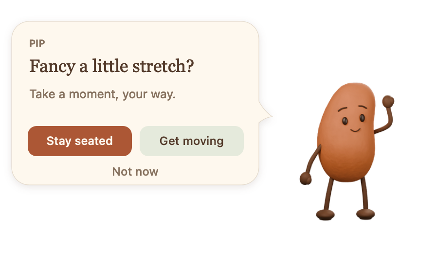

<h1 align="center">Stretch</h1>
<p align="center"><strong>A little pause. A little better.</strong></p>
<p align="center">Gentle movement breaks, with a little company.</p>
<p align="center">macOS 13+ · Apple Silicon · Early prototype · <a href="LICENSE">MIT licensed</a></p>

<p align="center">
  
</p>

Stretch lives in your Mac’s menu bar and pops by with a quiet invitation to stretch or breathe. Stay in your chair, get up for a moment, or tell it “not now”. A small pause, then back to your day.

Meet **Pip**, our first companion. Stretch is the app; Pip is one character in a cast we’d love to grow.

- **Stay seated or get moving.** Gentle reaches, turns, shoulder rolls and breathing, with seated and standing options.
- **Set your own rhythm.** Optional nudges every 15, 30, 45 or 60 minutes, with working hours and a 15-minute snooze.
- **Keep your focus.** Silent reminders and a transparent companion panel that appears without taking keyboard focus.
- **Make it your own.** Native Swift/AppKit source, editable Blender models and the complete animation library are included.

## Try Stretch

You’ll need an **Apple Silicon Mac**, **macOS 13 or later**, and **Apple Command Line Tools** (`xcode-select --install` if needed).

```sh
git clone --depth 1 https://github.com/jack-robinson-software/stretch.git
cd stretch/mac-app
./build.sh
./Stretch.app/Contents/MacOS/Stretch --self-test
open Stretch.app
```

On first launch, a short introduction lets you **meet Pip → try a pause → choose your rhythm → find Stretch in the menu bar**. Nudges start **off**, and you can skip the introduction at any point. No account or subscription is needed.

Replay it from **Settings → Replay introduction** or the menu bar’s **Replay introduction…**. [More about first launch](docs/ONBOARDING.md).

This is a source-build prototype; a signed, notarised download is not available yet. The repository includes the full character asset library, so the initial clone is approximately 700 MB.

**Just want a look?** Open [`mac-app/preview.html`](mac-app/preview.html) from your checkout in a browser. The interactive demo shows the flow; desktop reminders run in the Mac app.

## What’s here

| Area | What you’ll find |
| --- | --- |
| [`mac-app/`](mac-app/) | Native app, build instructions, packaged animation frames and browser preview |
| [`model/`](model/) | Pip’s editable neutral Blender model |
| [`animations/`](animations/) | Standing and walking scenes, transparent frames and video previews |
| [`seated/`](seated/) | Chair-based movements, editable scenes and exports |
| [`tools/blender/`](tools/blender/) | Model generation, animation, rendering and validation scripts |
| [`docs/`](docs/) | Architecture, character workflow and project roadmap |
| [`references/`](references/) · [`renders/`](renders/) | Design references and neutral character renders |

## Small, quiet and local

Stretch has no accounts, telemetry, AI calls or background network requests. Settings stay on your Mac. It does not use your camera, microphone or screen recording. Source and optional donation links open in your browser only when selected.

The prototype uses a timer and chosen working hours. Idle detection, call/Focus awareness, launch at login and a character picker are future work. See the [roadmap](docs/ROADMAP.md) and [app guide](mac-app/README.md) for the current scope.

## Help Stretch grow

Bug reports, thoughtful suggestions, movement ideas and new companions are welcome. Read the [contribution guide](CONTRIBUTING.md) for setup and checks, the [architecture guide](docs/ARCHITECTURE.md) for the code, or the [character guide](docs/CHARACTERS.md) for Pip’s assets.

<!-- support:start -->
Enjoying Stretch? [Buy me a coffee](https://www.buymeacoffee.com/jackrobinsonuk) to help it grow. Donations are completely optional.
<!-- support:end -->

## Licence

[MIT](LICENSE) © 2026 Jack Robinson. The source code and included character models, animations and renders are available under the same licence.
