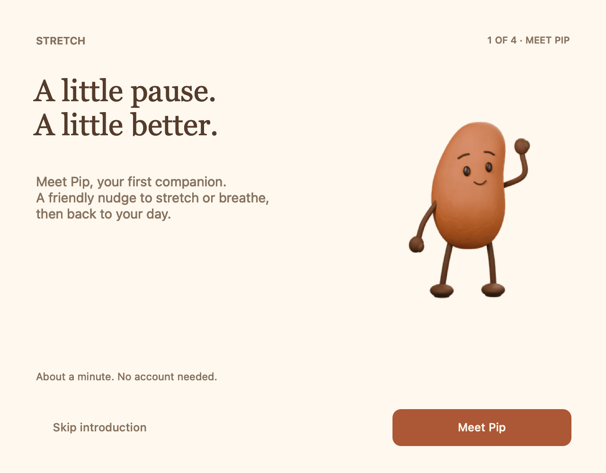

# A small introduction

Stretch’s first launch is a short, optional introduction. It requires no account or permissions.



## The four steps

1. **Meet Pip.** A greeting and a quick explanation of the app.
2. **Try a little pause.** Choose a seated reach or standing stretch and follow the actual clip in the window. You can switch movements or continue before the clip finishes.
3. **Choose your rhythm.** Set an interval and daily work hours, and optionally enable nudges. New users start with nudges off.
4. **Find us again.** See your chosen rhythm and use **Show me where** to reveal a hint anchored to the real menu-bar icon. **Let’s begin** saves the choices and invites Pip onto the desktop.

Back retains your draft choices. Skip, Escape and closing the window leave saved settings unchanged. Settings can always be changed later.

## Returning and replaying

The app remembers completion or dismissal locally. Existing prototype users who already met Pip are treated as returning users; the new introduction does not interrupt them automatically.

Replay from **Settings → Replay introduction**, the menu-bar **Replay introduction…** item, or:

```sh
open -n mac-app/Stretch.app --args --onboarding
```

A replay begins with your current settings. Skipping it discards the draft. Automatic nudges wait while the introduction is open.

## Implementation and checks

[`Onboarding.swift`](../mac-app/Sources/Onboarding.swift) uses the shared `CharacterView` and packaged clips. `ReminderDraft` and the completion preference live in [`AppModel.swift`](../mac-app/Sources/AppModel.swift). The final menu-bar hint is presented by the app, using its actual status button as the anchor.

The bundled self-test covers first-run defaults, draft isolation, completion, dismissal and migration from the earlier prototype. The native control check exercises navigation, both trial buttons, reminder opt-in, interval changes, the menu-hint callback, Back, Finish, replay, Skip and closing the window. Both use isolated preference suites.

```sh
./mac-app/build.sh
./mac-app/Stretch.app/Contents/MacOS/Stretch --self-test
./mac-app/Stretch.app/Contents/MacOS/Stretch --onboarding-self-test
```

For a visual review without altering preferences, `--capture /absolute/output/path` writes the four onboarding screens alongside the other native app views. Manual review should also check keyboard navigation, actual animation playback and the anchored menu-bar hint on the intended display setup.
